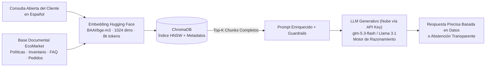
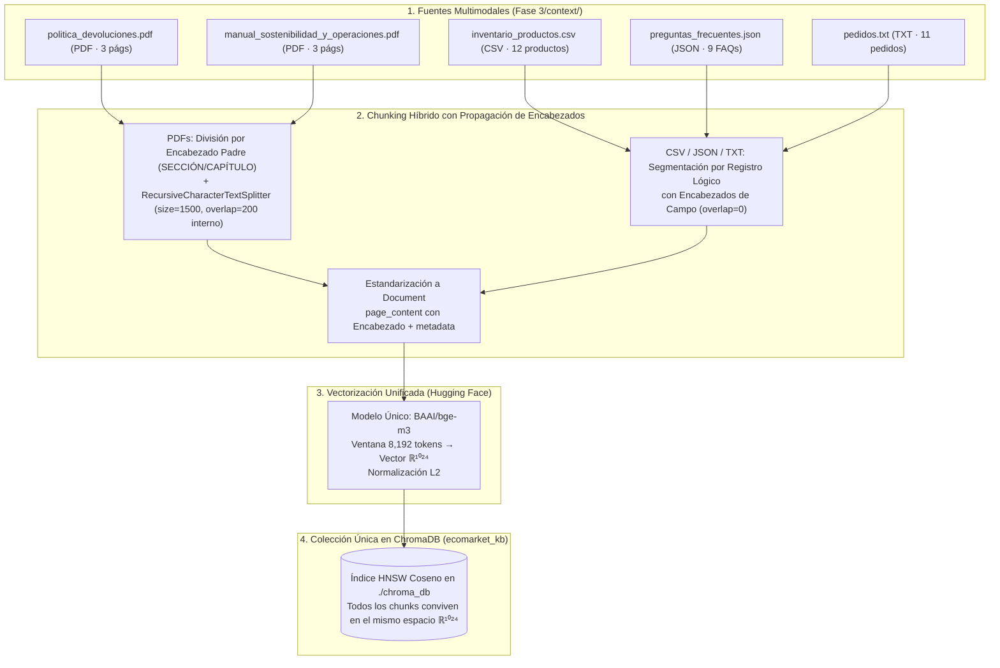

# Taller Práctico #2 — Implementación de un Sistema RAG para IA Generativa en EcoMarket

**Autores:** Anderson Pipicano, Fredy Alvarez  
**Asignatura:** Inteligencia Artificial Generativa  
**Objetivo:** Extender las capacidades de **EcoBot** (desarrollado inicialmente en el Taller Práctico #1) mediante una arquitectura **RAG (*Retrieval-Augmented Generation*)**, permitiéndole consultar una base de conocimiento vectorial interna para responder con precisión cualquier solicitud de los clientes o informar de manera transparente cuando no cuenta con las herramientas o información para atenderla.

> [NOTA]
> **Aclaración Técnica sobre el Modelo Generativo (LLM) para la Ejecución del Taller:**  
> En el diseño original del Taller #1 se consideró el uso de `Meta-Llama-3.1-8B-Instruct` a través de la API Serverless de Hugging Face. Sin embargo, la plataforma Hugging Face ha restringido el acceso gratuito a dicho modelo, exigiendo una suscripción de pago (*PRO / Warm / Dedicated Inference Endpoints*) para su consumo.  
> Por esta razón, y en estricto cumplimiento del criterio de la consigna (*"Detallar limitaciones y suposiciones: En caso de tener limitaciones de recursos para ejecutar la propuesta definida en este taller, detallar claramente la razón de estas limitaciones"*), para este taller se adopta el modelo **`glm-5.3-flash` consumido directamente desde la nube mediante su API Key**. Esta decisión evita la necesidad de tarjetas gráficas (GPU) dedicadas en el equipo local y sortea las barreras de pago de Hugging Face, manteniendo intacta la arquitectura RAG desacoplada (LangChain + ChromaDB + `BAAI/bge-m3`), donde el LLM opera en la nube como motor de razonamiento y redacción empática a partir del contexto recuperado.

---

## Fase 1: Selección de Componentes Clave del Sistema RAG

En el Taller Práctico #1 se definió que el modelo de lenguaje (`Meta-Llama-3.1-8B-Instruct`) debe operar como un **motor de razonamiento puro** sin *fine-tuning*, delegando el conocimiento del negocio a una capa externa de recuperación para evitar alucinaciones y obsolescencia de datos.

Para materializar esta arquitectura RAG, el sistema requiere dos piezas fundamentales antes de la generación de texto:
1. Un **Modelo de Embeddings**, encargado de transformar tanto los documentos corporativos de EcoMarket como las preguntas de los usuarios en representaciones matemáticas densas (vectores numéricos) dentro de un mismo espacio semántico.
2. Una **Base de Datos Vectorial**, responsable de indexar dichos vectores y ejecutar búsquedas por similitud matemática (como similitud del coseno o producto punto) en milisegundos para recuperar únicamente los fragmentos (*chunks*) relevantes.

A continuación, se presenta la evaluación técnica, comparativa y justificación de los componentes seleccionados para EcoMarket.

---

### 1. Selección del Modelo de Embeddings

#### 1.1. Decisión arquitectónica: ¿Código abierto (Hugging Face) o Propietario?

Se selecciona un modelo **de código abierto (*open-source*) alojado en Hugging Face**, específicamente **`BAAI/bge-m3`** (*Beijing Academy of Artificial Intelligence — Multi-Lingual, Multi-Functionality, Multi-Granularity*).

Durante el análisis arquitectónico se evaluaron otros modelos *open-source* populares en Hugging Face —como `sentence-transformers/paraphrase-multilingual-MiniLM-L12-v2` e `intfloat/multilingual-e5-large`— así como alternativas propietarias de pago por uso (`text-embedding-3-small` de OpenAI).

- **Por qué se descartan las alternativas propietarias (OpenAI / Cohere):** Manteniendo coherencia con los principios de EcoMarket definidos en el Taller #1, no se deben enviar documentos internos (pedidos, datos de clientes, políticas ni catálogo) a APIs comerciales cerradas que generan cobros perpetuos por token y riesgo de *vendor lock-in* (si un proveedor propietario actualiza o retira su modelo de embeddings, obliga a recalcular y re-indexar toda la base vectorial).
- **Por qué se descartan `MiniLM-L12-v2` y `multilingual-e5-large` frente a `BAAI/bge-m3`:** Aunque ambos son modelos *open-source* competentes en frases cortas, presentan un **cuello de botella crítico para entornos de producción debido a su límite máximo de tokens de entrada** (**128/256 tokens** en `MiniLM-L12-v2` y **512 tokens** en `multilingual-e5-large`), mientras que **`BAAI/bge-m3` soporta hasta 8,192 tokens**, garantizando escalabilidad documental sin truncamiento de información.

#### 1.2. Evaluación comparativa de alternativas de Embeddings

| Criterio | `BAAI/bge-m3` (Hugging Face — **Seleccionado**) | `intfloat/multilingual-e5-large` (Hugging Face) | `paraphrase-multilingual-MiniLM-L12-v2` (Hugging Face) | `text-embedding-3-small` (OpenAI — Propietario) |
| :--- | :--- | :--- | :--- | :--- |
| **Tipo de licencia** | **Open-Source (MIT)** | Open-Source (MIT) | Open-Source (Apache 2.0) | Propietario (API comercial cerrada) |
| **Límite máximo de tokens (Ventana)** | **8,192 tokens** (~6,000 palabras en español) | **512 tokens** (~350 palabras en español) | **128 – 256 tokens** (~90–180 palabras en español) | **8,192 tokens** |
| **Dimensión del vector** | **1024 dimensiones** | 1024 dimensiones | 384 dimensiones | 1536 dimensiones |
| **Capacidad en idioma español** | **Estado del arte (+100 idiomas):** Líder en *benchmarks* multilingües (MIRACL y MTEB) tanto en pasajes cortos como en documentos largos en español. | **Muy alta en pasajes cortos:** Excelente precisión semántica en español, pero restringida a fragmentos breves. | **Media-Alta:** Buena detección de paráfrasis simples, menor precisión en textos técnicos o normativos complejos. | **Alta:** Buen soporte general, aunque entrenado mayoritariamente en corpus en inglés. |
| **Tipo de recuperación soportada** | **Híbrida (3 en 1):** Densa (semántica), Léxica/Sparse (pesos tipo BM25 para códigos exactos como `ECO-10004`) y Multi-Vector (ColBERT). | Solo Densa (requiere prefijos obligatorios `"query: "` y `"passage: "`). | Solo Densa. | Solo Densa. |
| **Costo operativo** | **\$0 por token (Gratuito):** Consumible vía *Hugging Face Inference API* gratuita o en contenedor propio. | **\$0 por token (Gratuito):** Consumible vía *Hugging Face Inference API* o local. | **\$0 por token (Gratuito):** Muy ligero para CPU local. | **Pago variable por token** en cada indexación y en cada consulta de cliente. |
| **Escalabilidad en producción** | **Muy Alta:** Crece con la empresa sin truncar fichas técnicas, cláusulas legales ni reclamos extensos. | **Limitada por ventana:** Trunca silenciosamente cualquier *chunk* o mensaje de cliente que supere 512 tokens. | **Baja para documentos complejos:** Solo apto para frases o párrafos muy cortos. | **Alta**, pero sujeta a costos crecientes por volumen de tráfico. |

#### 1.3. Justificación de la elección de `BAAI/bge-m3` para EcoMarket

La selección de **`BAAI/bge-m3`** como modelo oficial de embeddings para EcoMarket se fundamenta en cinco pilares técnicos:

1. **Superación de la limitación de 512 tokens en producción (*Multi-Granularity*):**
   Modelos basados en arquitecturas clásicas como `intfloat/multilingual-e5-large` (512 tokens) o `MiniLM-L12-v2` (128/256 tokens) se quedan cortos en un entorno real de e-commerce. En español, el tokenizador multilingüe divide las palabras en aproximadamente $1.3$ a $1.5$ *sub-tokens*, por lo que 512 tokens equivalen a apenas ~350 palabras. Si una ficha de producto sostenible con tabla de especificaciones, una cláusula completa de garantías o un reclamo extenso enviado por un cliente supera ese umbral, un modelo de 512 tokens **trunca y descarta silenciosamente el resto del texto**, provocando pérdida de información crítica. Con su ventana de **8,192 tokens**, `BAAI/bge-m3` permite diseñar estrategias de *chunking* flexibles y semánticamente completas (Fase 2) sin riesgo de truncamiento.
2. **Escalabilidad empresarial garantizada:**
   A medida que EcoMarket incorpore nuevos tipos de documentos (manuales de proveedores ecológicos, certificaciones ambientales extensas, históricos de tickets de soporte o catálogos completos), `BAAI/bge-m3` soporta desde consultas de tres palabras hasta documentos de varias páginas sin necesidad de cambiar de modelo ni reconstruir la arquitectura. además de ofrecer capacidades de recuperación híbrida (semántica densa + coincidencia exacta de códigos como `ECO-10004` o SKUs de inventario).
3. **Precisión superior en idioma español:**
   `BAAI/bge-m3` lidera los *benchmarks* internacionales de recuperación multilingüe (`MIRACL`), capturando con alta fidelidad modismos, sinónimos y consultas coloquiales en español (*"¿qué hago si mi champú sólido llegó roto?"*, *"¿cómo pido que me devuelvan la plata?"*, *"seguimiento de mi paquete"*), proyectándolos con precisión en un espacio vectorial de **1024 dimensiones**.
4. **Costo \$0 y ejecución en la nube o contenedor propio:**
   En la Fase 3 (prototipo), `BAAI/bge-m3` se consume gratuitamente en la nube a través de **Hugging Face Inference API** (`HuggingFaceEndpointEmbeddings`) usando el mismo `HF_TOKEN` del proyecto, sin exigir memoria RAM ni tarjeta gráfica (GPU) en el computador local. En producción, al tener licencia abierta MIT y un tamaño compacto de **~568 millones de parámetros (~2.2 GB)**, puede desplegarse dentro de la misma infraestructura Docker de EcoMarket sin pagar licencias ni tokens a terceros.
5. **Compatibilidad total y equilibrio técnico con el LLM generativo (`glm-5.3-flash` en la nube vía API Key / `Meta-Llama-3.1-8B-Instruct`):**
   El modelo de embeddings (`BAAI/bge-m3`, arquitectura *encoder* de 0.56B parámetros) y el LLM generativo utilizado en este taller (**`glm-5.3-flash`** consumido en la nube mediante su API Key, o `Meta-Llama-3.1-8B-Instruct` en entornos con suscripción de Hugging Face) son **100 % compatibles y complementarios**, ya que se comunican exclusivamente a través de texto plano recuperado por ChromaDB:
   - **Independencia del LLM frente al recuperador:** El cambio pragmático de `Llama-3.1-8B-Instruct` hacia `glm-5.3-flash` en la nube (debido al cobro obligatorio en los endpoints serverless de Hugging Face) no altera en absoluto la arquitectura RAG. `BAAI/bge-m3` realiza la búsqueda semántica en ChromaDB y le entrega al LLM únicamente los *chunks* exactos en lenguaje natural.
   - **Sinergia y protección contra alucinaciones:** Un modelo generativo rápido y ligero como `glm-5.3-flash` se beneficia enormemente de la precisión de `BAAI/bge-m3`. Al alimentarlo con fragmentos íntegros y no truncados, el LLM puede concentrar su capacidad en razonar y redactar respuestas empáticas sin divagar ni alucinar por falta de contexto.

---

### 2. Selección de la Base de Datos Vectorial

Una vez convertidos los fragmentos de documentos en vectores de **1024 dimensiones** mediante `BAAI/bge-m3`, es necesario almacenarlos en un motor especializado que permita realizar búsquedas de vecinos más cercanos aproximados (**ANN — *Approximate Nearest Neighbors***, mediante índices **HNSW**).

#### 2.1. Exploración comparativa: ChromaDB vs. Pinecone vs. Weaviate

Se analizaron las tres alternativas propuestas evaluando **escalabilidad**, **costo** y **facilidad de uso** para el caso de estudio de EcoMarket:

| Criterio | **ChromaDB** (**Seleccionada**) | **Pinecone** | **Weaviate** |
| :--- | :--- | :--- | :--- |
| **Naturaleza y Despliegue** | **Open-Source (Apache 2.0):** Funciona de forma embebida en Python (persistencia local en disco) o en modo cliente-servidor sobre Docker. | **100 % Propietario y Cloud (*Managed SaaS*):** Solo existe en la nube de Pinecone; no se puede instalar localmente ni autoalojar. | **Open-Source (BSD-3) / Cloud:** Motor robusto basado en contenedores (Docker/Kubernetes) o servicio administrado en la nube. |
| **Facilidad de uso e integración** | **Muy Alta:** Se instala con `pip install chromadb`, no requiere levantar infraestructura externa para el prototipo y se integra nativamente con LangChain en pocas líneas de código. | **Media-Alta:** No requiere administrar servidores, pero exige cuenta externa, gestión de `API Keys` adicionales, configuración de índices remotos y dependencia de red. | **Media-Baja:** Requiere definir esquemas (*schemas*) más estrictos, levantar contenedores Docker y configurar módulos desde el inicio. |
| **Costo para EcoMarket** | **Gratuito (\$0):** Sin cobros por cantidad de vectores almacenados ni por operaciones de lectura/escritura. Solo consume almacenamiento en disco. | **Alto a mediano/largo plazo:** Cuenta con una capa gratuita limitada (*Starter*), pero cobra por hora de almacenamiento o por millón de operaciones de lectura/escritura en producción. | **Gratuito (Autoalojado) / Pago (Cloud):** Sin costo de licencia en infraestructura propia, pero exige servidores con mayor memoria RAM base. |
| **Escalabilidad** | **Óptima para escala pequeña y mediana** (desde cientos hasta varios millones de vectores de 1024 dimensiones). Permite iniciar embebido en disco y evolucionar a servidor Docker. | **Muy Alta (Escala empresarial masiva):** Diseñado para cientos de millones o miles de millones de vectores con replicación global automática. | **Muy Alta:** Excelente escalabilidad horizontal, clústeres distribuidos y búsqueda híbrida a gran escala. |
| **Ventajas clave para EcoMarket** | • Cero fricción de configuración.<br>• Persistencia directa en disco (`persist_directory`).<br>• Filtrado por metadatos (`fuente`, `categoria`, `id`).<br>• Privacidad total de datos corporativos. | • Infraestructura totalmente delegada.<br>• Alta disponibilidad gestionada por terceros. | • Búsqueda híbrida nativa en el motor.<br>• Arquitectura pensada para microservicios de gran escala. |
| **Desventajas para EcoMarket** | • No está diseñado para clústeres distribuidos de miles de millones de vectores como Pinecone o Weaviate. | • *Vendor lock-in* (dependencia de proveedor).<br>• Los datos de EcoMarket salen a servidores externos.<br>• Costo variable creciente. | • Sobredimensionado (*overkill*) para la etapa actual de EcoMarket; mayor complejidad operativa e infraestructura más pesada. |

#### 2.2. Justificación de la elección de ChromaDB para EcoMarket

Se selecciona **ChromaDB** como base de datos vectorial para el sistema RAG de EcoMarket por cinco razones estratégicas y técnicas:

1. **Adecuación al volumen documental y transición fluida a producción:** La base de conocimiento de atención al cliente de EcoMarket (políticas corporativas, preguntas frecuentes, catálogo de productos ecológicos y estados de pedidos) representa entre cientos y decenas de miles de fragmentos vectoriales de 1024 dimensiones. ChromaDB utiliza internamente índices **HNSW (*Hierarchical Navigable Small World*)** persistidos sobre SQLite, resolviendo búsquedas por similitud de coseno en **menos de 10 milisegundos** sin el sobrecosto financiero de Pinecone ni la complejidad de infraestructura de Weaviate. Además, permite iniciar en modo local persistente y, en producción, ejecutarse como un contenedor Docker cliente-servidor (`chroma run`).
2. **Facilidad de uso y reproducibilidad inmediata:** Para la Fase 3 del proyecto, el repositorio de GitHub debe poder ejecutarse de forma autónoma y limpia. Con ChromaDB, la base vectorial se almacena directamente en un directorio del proyecto (`./chroma_db`) sin exigir cuentas adicionales ni servicios externos de pago.
3. **Coherencia con el ecosistema 100 % Open-Source de EcoMarket:** Combinar **ChromaDB** + **`BAAI/bge-m3`** + **`Meta-Llama-3.1-8B-Instruct`** consolida un *stack* tecnológico enteramente abierto, auditable, libre de cobros por transacción y respetuoso con la privacidad de los datos de los clientes.
4. **Bajo consumo de recursos computacionales (*Low-Resource Footprint*):** A diferencia de motores vectoriales empresariales pesados como Weaviate o Milvus —que requieren inicializar clústeres basados en Java o Go con microservicios auxiliares y reservar entre 4 GB y 8 GB de memoria RAM base solo para arrancar el servicio—, ChromaDB opera de forma embebida en memoria y disco persistente con un consumo mínimo de RAM (~100–300 MB para el volumen documental de EcoMarket) y una huella de CPU casi imperceptible durante las consultas ANN. Esto permite que el sistema se desarrolle, pruebe y ejecute fluidamente en computadores personales sin sobrecargar el hardware, manteniendo costos mínimos de infraestructura en servidores de producción.
5. **Implementación ágil sin esquemas estrictos (*Schema-less Flexibility*) y facilidad de migración hacia Weaviate:**
   - **Cero fricción por definición de esquemas rígidos:** Motores como Weaviate exigen declarar formalmente clases, propiedades de datos, vectorizadores por campo y tipos primitivos estrictos antes de insertar el primer vector. En contraste, ChromaDB ofrece una ingesta completamente dinámica y sin esquema (*schema-less*): recibe directamente texto (`documents`), metadatos en diccionarios JSON libres (`metadatas`) e IDs únicos (`ids`). Esto agiliza enormemente el desarrollo e iteración en EcoMarket al integrar fuentes documentales tan diversas (PDFs normativos, catálogos CSV y preguntas frecuentes en JSON) sin riesgo de bloqueos por discrepancias de esquema.
   - **Facilidad de migración transparente hacia Weaviate:** Gracias a que la arquitectura de EcoMarket se diseña utilizando la abstracción estándar de `VectorStore` en LangChain, la lógica de recuperación está 100 % desacoplada de la base de datos subyacente. Si en el futuro EcoMarket escala a decenas de millones de vectores o requiere un clúster distribuido multi-región con búsqueda híbrida BM25 nativa en el motor, la migración desde ChromaDB hacia Weaviate es directa: se realiza sustituyendo únicamente el conector de conexión (`WeaviateVectorStore` en lugar de `Chroma`) e indexando los mismos fragmentos ya estandarizados, sin necesidad de modificar los prompts, los documentos de contexto ni el flujo de inferencia de `Meta-Llama-3.1-8B-Instruct`.

---

### 3. Impacto de los Componentes Seleccionados en la Eficacia del Sistema RAG

El rendimiento de un sistema RAG depende de que la etapa de recuperación (*Retrieval*) alimente con contexto fidedigno a la etapa de generación (*Augmented Generation*). La integración de **`BAAI/bge-m3` + `ChromaDB` + `Meta-Llama-3.1-8B-Instruct`** impacta directamente en la eficacia de **EcoBot** en cuatro dimensiones:



1. **Eliminación de alucinaciones y preservación del contexto completo:** Gracias a la ventana de **8,192 tokens** de `BAAI/bge-m3` y sus vectores de **1024 dimensiones**, ningún fragmento documental sufre truncamiento silencioso al ser indexado en ChromaDB. Así, cuando el LLM (`glm-5.3-flash` en la nube vía API Key o `Llama-3.1-8B-Instruct`) recibe los *Top-K* fragmentos recuperados, dispone de reglas, políticas y datos de productos íntegros para responder con exactitud.
2. **Capacidad de atender cualquier solicitud o abstenerse responsablemente:** A diferencia del Taller #1 (donde el usuario debía elegir manualmente entre `pedido` o `devolucion` por línea de comandos), el par `BAAI/bge-m3` + `ChromaDB` vectoriza **cualquier consulta abierta del usuario** y busca transversalmente en toda la base de conocimiento de EcoMarket. Si el cliente realiza una solicitud sobre un tema que no existe en los documentos recuperados o requiere herramientas externas no disponibles, los *guardrails* del prompt instruyen al LLM para informarle honestamente que no cuenta con la información o herramientas para resolver esa solicitud, evitando inventar respuestas.
3. **Optimización de tokens y latencia en el LLM:** En lugar de inyectar todos los archivos de la empresa dentro del prompt en cada llamada (enfoque que colapsaría al escalar el catálogo y el histórico de pedidos), ChromaDB filtra en milisegundos únicamente los fragmentos relevantes, reduciendo el consumo de tokens de entrada en el LLM y acelerando el tiempo de respuesta.
4. **Trazabilidad mediante metadatos:** Cada vector de 1024 dimensiones almacenado en ChromaDB conserva metadatos estructurados (`fuente`, `tipo_documento`, `seccion`), permitiendo auditar de qué documento oficial provino cada respuesta entregada por EcoBot al cliente.

---

## Fase 2: Creación de la Base de Conocimiento de Documentos

El éxito de un sistema RAG depende directamente de la **calidad, riqueza y granularidad** de la información que puede recuperar. Incluso con un modelo de embeddings de última generación (`BAAI/bge-m3`) y una base vectorial rápida (`ChromaDB`), si los documentos originales son ambiguos o si se dividen rompiendo el sentido lógico de las frases, el modelo generativo (`glm-5.3-flash` en la nube / `Meta-Llama-3.1-8B-Instruct`) recibirá contexto incompleto y producirá respuestas imprecisas.

En esta fase se diseña e implementa la **Base de Conocimiento multimodal** de EcoMarket en la carpeta [`Fase 3/context/`](../Fase%203/context/), abarcando **cinco fuentes documentales** distribuidas en **cuatro formatos estándar de la industria** (`.pdf`, `.csv`, `.json` y `.txt`), incluyendo dos documentos corporativos extensos en formato **PDF** cuyas secciones densas validan en la práctica la necesidad de la ventana de **8,192 tokens** del modelo `BAAI/bge-m3` elegido en la Fase 1.

---

### 1. Identificación de Documentos Cruciales para EcoMarket

Para que **EcoBot** evolucione del Taller #1 (donde solo respondía consultas aisladas de pedidos o devoluciones con textos cortos) hacia un asistente integral capaz de responder **cualquier consulta normativa, técnica, logística o comercial** —o identificar con certeza cuándo no tiene las herramientas para resolverla—, se definieron e implementaron **5 documentos complementarios**:

| # | Archivo en `Fase 3/context/` | Formato | Extensión / Volumen | Tipo de Documento e Información Crucial para Atención al Cliente |
| :-: | :--- | :---: | :---: | :--- |
| **1** | [`politica_devoluciones.pdf`](../Fase%203/context/politica_devoluciones.pdf) | **PDF** (`.pdf`) | **3 páginas** (~1,430 palabras / ~2,000 tokens) | **Política Integral de Devoluciones, Cambios, Retractos y Garantías (`POL-SAC-2026-V2`):** Marco legal (Ley 1480 Estatuto del Consumidor), reglas de elegibilidad de 30 días, aclaración sobre estado *"Entregado"*, requisitos obligatorios de validación, excepciones sanitarias detalladas (perecederos, higiene personal abiertos vs. sellados), protocolo de garantías/daños en transporte (escalamiento obligatorio a agente humano) y proceso de logística inversa en 3 pasos con plazos de reembolso. |
| **2** | [`manual_sostenibilidad_y_operaciones.pdf`](../Fase%203/context/manual_sostenibilidad_y_operaciones.pdf) | **PDF** (`.pdf`) | **3 páginas** (~1,575 palabras / ~2,200 tokens) | **Manual Corporativo de Sostenibilidad, Certificaciones Ambientales, Logística Verde y Cuidado Técnico (`MAN-OPS-SOST-2026`):** Detalle técnico de certificaciones (*GOTS*, *Cruelty-Free*, *Reef-Safe* para arrecifes de coral, *Libre de BPA*, bagazo de caña), manual de mantenimiento, lavado y compostaje/reciclaje al final de la vida útil por línea de producto, protocolo de empaque *Cero Plástico*, tiempos de ciclo por estado logístico, programa *EcoPuntos* / envases retornables y **fronteras operativas explícitas de EcoBot**. |
| **3** | [`inventario_productos.csv`](../Fase%203/context/inventario_productos.csv) | **Hoja de cálculo** (`.csv`) | **12 registros tabulares** | **Catálogo Maestro e Inventario de Productos:** Fichas estructuradas (`PROD-001` a `PROD-012`) con `sku`, `producto`, `categoria` (*Higiene Personal*, *Hogar y Cocina*, *Alimentos Perecederos*, *Papelería Ecológica*, etc.), `precio_cop`, `stock_disponible`, `estado_inventario` (*Disponible* / *Agotado*), `materiales_certificaciones` y `descripcion_y_uso`. |
| **4** | [`preguntas_frecuentes.json`](../Fase%203/context/preguntas_frecuentes.json) | **JSON** (`.json`) | **9 objetos clave-valor** | **Preguntas Frecuentes (FAQ):** Consultas rápidas (`FAQ-001` a `FAQ-009`) sobre costos de envío (\$12.000 COP o gratis desde \$120.000 COP), cobertura nacional, medios de pago (PSE, tarjetas, Nequi, Daviplata, contra entrega), tiempos de reembolso y horarios de atención de agentes humanos. |
| **5** | [`pedidos.txt`](../Fase%203/context/pedidos.txt) | **Texto por bloques** (`.txt`) | **11 registros** (`ECO-10001` a `ECO-10011`) | **Base de Seguimiento Logístico de Pedidos:** Estado operativo en curso (*En tránsito*, *Entregado*, *Preparando envío*, *Retrasado*), producto asociado, fecha estimada o de entrega, motivo de retraso, transportadora (*Servientrega*, *Coordinadora*, *Interrapidísimo*) y enlace de rastreo. |

#### 1.1. Sinergia documental y validación empírica de `BAAI/bge-m3` (Fase 1)
La inclusión de los dos documentos extensos en formato **PDF** ([`politica_devoluciones.pdf`](../Fase%203/context/politica_devoluciones.pdf) y [`manual_sostenibilidad_y_operaciones.pdf`](../Fase%203/context/manual_sostenibilidad_y_operaciones.pdf)) cumple un doble propósito arquitectónico:
1. **Razonamiento cruzado (*Multi-Hop Retrieval*) sobre casos reales del negocio:**
   - Si un cliente pregunta *"¿Cómo debo lavar mi termo de acero inoxidable y qué pasa si pierde la capacidad de mantener el calor?"*, el RAG combina el **Capítulo 2.1** de `manual_sostenibilidad_y_operaciones.pdf` (lavado a mano con agua tibia y bicarbonato, prohibición de microondas/congelador) con la **Sección 4 (Numeral 7)** de `politica_devoluciones.pdf` y `PROD-006` de `inventario_productos.csv` (garantía técnica de 6 meses por defecto en el sello térmico y escalamiento obligatorio a agente humano).
   - Si pregunta *"¿Puedo usar el protector solar en un parque natural marino y puedo devolver el envase vacío?"*, el RAG cruza el **Capítulo 1** (*Certificación Reef-Safe con óxido de zinc no-nano*) y el **Capítulo 4.1** (*Programa de Retorno Circular con bono de \$5.000 COP*) de `manual_sostenibilidad_y_operaciones.pdf`.
2. **Justificación directa del modelo de embeddings `BAAI/bge-m3` frente al límite de 512 tokens:**
   Las secciones normativas de `politica_devoluciones.pdf` (como la Sección 2 de Elegibilidad o la Sección 5 de Logística Inversa) y los capítulos técnicos de `manual_sostenibilidad_y_operaciones.pdf` contienen entre **350 y 650 palabras por sección (~500 a 900 tokens en español)**.
   - Si hubiésemos utilizado `paraphrase-multilingual-MiniLM-L12-v2` (límite de 128–256 tokens) o `intfloat/multilingual-e5-large` (límite rígido de 512 tokens), estas secciones PDF **habrían sufrido truncamiento silencioso al vectorizarse** (perdiendo, por ejemplo, el Paso 3 de los plazos de reembolso o las instrucciones de compostaje del cepillo de bambú), o habrían obligado a partir cada cláusula en micro-fragmentos inconexos.
   - Gracias a la ventana de **8,192 tokens** de **`BAAI/bge-m3`**, podemos preservar secciones normativas y técnicas extensas con su contexto completo intacto.

---

### 2. Estrategia de Segmentación (*Chunking*), Jerarquía de Encabezados y Solapamiento (*Overlap*)

La segmentación (*chunking*) consiste en dividir los documentos originales en fragmentos manejables antes de convertirlos en vectores. Aunque los 5 archivos convergen en **un único sistema RAG** y son vectorizados con el **mismo modelo `BAAI/bge-m3`**, la estrategia de corte de texto debe adaptarse a la naturaleza estructural de cada formato documental para optimizar dos métricas críticas:
- **Precisión de Recuperación (*Retrieval Precision*):** Evitar la *dilución semántica* que ocurre cuando se mezclan múltiples temas, productos o pedidos dentro de un mismo vector.
- **Integridad del Contexto (*Context Completeness*):** Evitar la *fragmentación de contexto* o los **"fragmentos huérfanos"** (aquellos que pierden el encabezado de la sección o la columna a la que pertenecen).

#### 2.1. Análisis comparativo de estrategias de segmentación

| Estrategia de *Chunking* | Cómo funciona | Ventajas | Desventajas críticas en EcoMarket |
| :--- | :--- | :--- | :--- |
| **1. Por Tamaño Fijo (*Fixed-Size Chunking*)** | Corta el texto rígidamente cada $N$ caracteres o tokens sin evaluar saltos de párrafo, títulos ni estructura. | Implementación elemental y tamaño uniforme. | **Inviable para EcoMarket:** Corta frases legales a mitad de camino en los PDFs y parte registros de `pedidos.txt` (separando el código `ECO-10004` de su estado `Retrasado`). |
| **2. Por Párrafos Simples (*Paragraph Splitting*)** | Divide únicamente por dobles saltos de línea (`\n\n`). | Respeta párrafos aislados en prosa simple. | **Produce fragmentos huérfanos en PDFs y falla en CSV/JSON:** Un párrafo como *"6. Productos de higiene sin abrir..."* queda separado de su título padre (`SECCIÓN 3. EXCEPCIONES NORMATIVAS`), perdiendo su jerarquía temática. |
| **3. Recursiva por Caracteres (`RecursiveCharacterTextSplitter`)** | Divide jerárquicamente usando una lista priorizada de separadores (`["\n\n", "\n", ". ", " "]`) hasta alcanzar un `chunk_size` objetivo con un `chunk_overlap` configurable. | Mantiene juntas las oraciones y párrafos relacionados cuando una sección es muy extensa. | Si se usa aisladamente sin **propagación de encabezados**, el segundo fragmento de una sección larga pierde el título de la sección; y si se usa en CSV/JSON, mezcla registros. |
| **4. Basada en Encabezados Jerárquicos (*Header-Aware Splitting*)** | Detecta los títulos y subtítulos estructurales del documento (`SECCIÓN X`, `CAPÍTULO Y`, subcapítulo `2.1`) y **propaga e inyecta el encabezado padre** al inicio de cada *chunk* hijo generado dentro de esa sección. | **Elimina los fragmentos huérfanos en los PDFs:** Cada *chunk* sabe exactamente a qué documento, capítulo y sección pertenece antes de vectorizarse con `BAAI/bge-m3`. | Debe combinarse con división recursiva interna en caso de que una misma sección supere el `chunk_size` máximo. |
| **5. Basada en Estructura / Registro Lógico (*Record-Aware*)** | Convierte cada unidad estructurada (fila de `.csv` con sus encabezados de columna, objeto de `.json`, bloque `PEDIDO X`) en un *chunk* atómico y autocontenido. | **100 % de exactitud en datos tabulares y transaccionales:** Cada vector representa exactamente 1 producto del catálogo, 1 FAQ o 1 pedido. | Solo aplica a archivos estructurados o semi-estructurados (`.csv`, `.json`, bloques `.txt`), no a prosa extensa en PDF. |

#### 2.2. Estrategia seleccionada para EcoMarket: Segmentación Híbrida con Propagación de Encabezados

Tras analizar el contenido real de cada uno de los 5 archivos de [`Fase 3/context/`](../Fase%203/context/), se implementa una **Estrategia Híbrida (Basada en Encabezados Jerárquicos + Recursiva para PDFs, y Basada en Registro Lógico con Encabezados de Columna para CSV/JSON/TXT)**:

1. **En los documentos PDF extensos (`politica_devoluciones.pdf` y `manual_sostenibilidad_y_operaciones.pdf`) — *Segmentación por Encabezados (`SECCIÓN` / `CAPÍTULO`) + `RecursiveCharacterTextSplitter` Interno*:**
   - **Paso A (División por Encabezados Mayoritarios):** El documento PDF se divide primero respetando sus fronteras lógicas de primer nivel (`SECCIÓN 1` a `SECCIÓN 5` en la política; `CAPÍTULO 1` a `CAPÍTULO 4` en el manual).
   - **Paso B (Propagación de Encabezado Padre + División Recursiva):** Si una sección completa cabe dentro del `chunk_size = 1500` caracteres, se conserva como un único *chunk* íntegro. Si una sección supera los `1500` caracteres (por ejemplo, el Capítulo 2 del manual con las 4 líneas de productos), `RecursiveCharacterTextSplitter` la subdivide por subencabezados/párrafos (`["\n2.", "\n3.", "\n4.", "\n•", "\n\n", "\n", ". "]`), **pero inyectando siempre al inicio de cada sub-fragmento el título del documento y el encabezado de la Sección/Capítulo padre**:
     ```text
     [FUENTE: manual_sostenibilidad_y_operaciones.pdf | SECCIÓN: CAPÍTULO 2. GUÍA TÉCNICA DE USO, MANTENIMIENTO, LAVADO Y DISPOSICIÓN AL FINAL DE LA VIDA ÚTIL]
     2.2. Línea de Cuidado Oral y Corporal en Barra (Cepillo de Bambú PROD-002...): ...
     ```
   - **Beneficio clave:** Cuando `BAAI/bge-m3` convierte ese *chunk* en un vector de 1024 dimensiones, el vector codifica simultáneamente tanto el detalle específico del párrafo como el tema global de su encabezado padre.

2. **En los archivos estructurados (`inventario_productos.csv`, `preguntas_frecuentes.json` y `pedidos.txt`) — *Segmentación por Registro Lógico con Inyección de Encabezados de Campo*:**
   - **Catálogo (`inventario_productos.csv` — 12 productos):** En un CSV crudo, los encabezados (`sku,producto,categoria,precio_cop...`) solo están en la fila 1. Si no se propagaran los encabezados a cada fila, el *chunk* de la fila 9 perdería el significado de sus números. Por ello, cada fila se convierte en un *chunk* independiente que **repite explícitamente los encabezados de columna** (`SKU: PROD-009 | Producto: Protector solar ecológico | Categoría: Cuidado Personal e Higiene | Precio: $62.000 COP | Stock disponible: 31...`).
   - **Preguntas Frecuentes (`preguntas_frecuentes.json` — 9 FAQs):** Cada objeto JSON se serializa en un *chunk* unitario con sus etiquetas de encabezado (`ID FAQ`, `Categoría`, `Pregunta`, `Respuesta oficial`).
   - **Pedidos (`pedidos.txt` — 11 pedidos):** Se segmenta por el encabezado de bloque `PEDIDO X`, generando exactamente 11 *chunks* independientes (`ECO-10001` a `ECO-10011`).

#### 2.3. Estrategia de Solapamiento (*Chunk Overlap*): ¿Cuándo usarla y por qué NO usarla en registros independientes?

El **solapamiento (*chunk overlap*)** consiste en repetir los últimos $M$ caracteres del `Chunk i` al comienzo del `Chunk i+1`. Lejos de aplicar un valor único a ciegas, en EcoMarket se aplica una **política de solapamiento diferenciado** justificada técnicamente:

| Tipo de Fuente / Frontera | Configuración de `chunk_overlap` | Justificación Técnica: ¿Por qué SÍ o por qué NO solapar? |
| :--- | :---: | :--- |
| **Dentro de una misma Sección o Capítulo extenso de un PDF** (`politica_devoluciones.pdf`, `manual_sostenibilidad_y_operaciones.pdf`) | **SÍ se usa solapamiento:**<br>`chunk_overlap = 200` caracteres (~13 % del `chunk_size`) | **Preserva la cohesión sintáctica y anafórica:** Cuando una sección normativa o técnica larga se divide en dos fragmentos contiguos (`Sub-chunk A` y `Sub-chunk B`), es frecuente que una oración empiece diciendo *"En estos escenarios, EcoBot tiene prohibido..."* o *"Aprobada dicha inspección..."*. El solapamiento de 200 caracteres garantiza que la última oración del `Sub-chunk A` aparezca también al inicio del `Sub-chunk B`, evitando perder el antecedente de la regla. |
| **Entre dos Secciones/Capítulos distintos de un PDF** (ej. fin de `SECCIÓN 2` e inicio de `SECCIÓN 3`) | **NO se usa solapamiento:**<br>`chunk_overlap = 0` en fronteras de encabezado | **Evita mezclar temas normativos opuestos:** Como el documento primero se separa por encabezados (`SECCIÓN X`), no tiene sentido pegar el final de la *Sección 2 (Productos generales retornables)* al inicio de la *Sección 3 (Excepciones sanitarias no retornables)*. Eso contaminaría el vector de la Sección 3 con reglas de la Sección 2. |
| **En registros estructurados e independientes** (`pedidos.txt`, `inventario_productos.csv`, `preguntas_frecuentes.json`) | **PROHIBIDO usar solapamiento:**<br>`chunk_overlap = 0` | **Previene la contaminación cruzada entre registros (*Cross-Record Pollution*):** Cada pedido (`ECO-10001` … `ECO-10011`), cada producto (`PROD-001` … `PROD-012`) y cada FAQ (`FAQ-001` … `FAQ-009`) es una entidad atómica e independiente.<br>• Si aplicáramos solapamiento en `pedidos.txt`, el *chunk* del `PEDIDO 5 (ECO-10005 - Shampoo sólido - En tránsito)` incluiría en su parte superior las últimas líneas del `PEDIDO 4 (ECO-10004 - Retrasado - Servientrega)`, induciendo al LLM a mezclar el estado o la transportadora de un cliente con otro.<br>• Del mismo modo, solapar filas en `inventario_productos.csv` mezclaría el estado *Agotado* del `PROD-007` con el `PROD-008`. Por tanto, en unidades lógicas autocontenidas el solapamiento debe ser estrictamente **cero (`0`)**. |

---

### 3. Proceso de Indexación y Representación Unificada en ChromaDB

Los **5 archivos** de [`Fase 3/context/`](../Fase%203/context/) no crean 5 sistemas RAG aislados, sino que **alimentan una única colección vectorial unificada (`ecomarket_kb`) dentro de ChromaDB**. Mientras la estrategia de *chunking* se adapta a cada formato de entrada, **la etapa de vectorización es única e idéntica para todos los fragmentos (`BAAI/bge-m3`)**, proyectándolos en el mismo espacio matemático de **1024 dimensiones** para que una sola consulta del cliente pueda recuperar evidencia combinada de cualquiera de los 5 documentos.



#### 3.1. Las 4 etapas del pipeline de indexación

1. **Etapa 1 — Extracción Multimodal y Normalización:**
   El indexador recorre [`Fase 3/context/`](../Fase%203/context/) y procesa cada archivo según su extensión: extrae el texto de las páginas de los **`.pdf`** con `pymupdf`, parsea las filas de **`.csv`** con `csv.DictReader`, carga los objetos de **`.json`** con `json.loads` y separa los bloques de **`.txt`**.
2. **Etapa 2 — Segmentación con Inyección de Encabezados y Metadatos:**
   Se aplica la estrategia de la Sección 2.2 y 2.3. Cada fragmento resultante se empaqueta en un objeto `Document` cuyo texto (`page_content`) inicia siempre con su encabezado jerárquico (`[FUENTE: ... | SECCIÓN/REFERENCIA: ...]`) y cuyo diccionario `metadata` almacena `fuente`, `tipo` (`politica_pdf`, `manual_pdf`, `inventario`, `faq`, `pedido`) y `referencia`.
3. **Etapa 3 — Vectorización Unificada ($\mathbb{R}^{1024}$) con `BAAI/bge-m3`:**
   Todos los *chunks* generados a partir de las 5 fuentes se envían al modelo **`BAAI/bge-m3`**, obteniendo para cada uno un vector denso normalizado de **1024 dimensiones** ($\vec{v} \in \mathbb{R}^{1024}$).
4. **Etapa 4 — Almacenamiento en la Colección Unificada de ChromaDB:**
   Los registros se guardan en la colección `ecomarket_kb` de **ChromaDB** (`Fase 3/chroma_db/`) bajo un índice **HNSW** con similitud del coseno. Se incluye verificación por *hash* SHA-256 de los archivos fuente para cargar el índice instantáneamente desde disco en ejecuciones sucesivas y reconstruirlo automáticamente solo si cambia algún documento en `Fase 3/context/`.

#### 3.2. ¿Cómo se ve la representación interna dentro de ChromaDB?

Dentro de la colección única `ecomarket_kb` en ChromaDB, todos los fragmentos de los 5 archivos quedan almacenados en una estructura homogénea de **4 atributos por registro**:

| `id` (Clave única) | `embedding` (Vector $\mathbb{R}^{1024}$ de `BAAI/bge-m3`) | `document` (`page_content` con Encabezado Propagado) | `metadata` (Diccionario de filtrado y trazabilidad) |
| :--- | :--- | :--- | :--- |
| `pol_sec3_01` | `[0.028, -0.049, ..., 0.081]` | `"[FUENTE: politica_devoluciones.pdf \| SECCIÓN 3. EXCEPCIONES NORMATIVAS Y PRODUCTOS NO RETORNABLES] 5. Productos de higiene personal y cuidado corporal abiertos: NO pueden devolverse..."` | `{"fuente": "politica_devoluciones.pdf", "tipo": "politica_pdf", "referencia": "SECCION_3"}` |
| `man_cap2_02` | `[-0.012, 0.063, ..., -0.015]` | `"[FUENTE: manual_sostenibilidad_y_operaciones.pdf \| CAPÍTULO 2. GUÍA TÉCNICA DE USO, MANTENIMIENTO...] 2.2. Línea de Cuidado Oral y Corporal en Barra (Cepillo de Bambú PROD-002...)"` | `{"fuente": "manual_sostenibilidad_y_operaciones.pdf", "tipo": "manual_pdf", "referencia": "CAPITULO_2"}` |
| `inv_PROD-005` | `[0.019, -0.038, ..., 0.072]` | `"[FUENTE: inventario_productos.csv \| SKU: PROD-005] Producto: Shampoo sólido natural \| Categoría: Higiene Personal \| Precio: $38.000 COP \| Stock: 64 (Disponible)..."` | `{"fuente": "inventario_productos.csv", "tipo": "inventario", "referencia": "PROD-005"}` |
| `faq_FAQ-006` | `[0.031, -0.051, ..., 0.064]` | `"[FUENTE: preguntas_frecuentes.json \| ID: FAQ-006 \| Categoría: Devoluciones y Garantías] Pregunta: ¿Qué productos son considerados de higiene personal...? Respuesta: ..."` | `{"fuente": "preguntas_frecuentes.json", "tipo": "faq", "referencia": "FAQ-006"}` |
| `ped_ECO-10005` | `[0.021, -0.044, ..., 0.089]` | `"[FUENTE: pedidos.txt \| PEDIDO 5 \| GUÍA: ECO-10005] Número de seguimiento: ECO-10005 \| Producto: Shampoo sólido natural \| Estado: En tránsito..."` | `{"fuente": "pedidos.txt", "tipo": "pedido", "referencia": "ECO-10005"}` |

#### 3.3. Ventajas operativas de ChromaDB en la ingesta: Bajos recursos, ausencia de esquemas y ruta de migración a Weaviate

La elección de ChromaDB para materializar la base de conocimiento de EcoMarket en esta Fase 2 aporta tres ventajas prácticas fundamentales:

1. **Bajo consumo de recursos computacionales durante la indexación:**
   A diferencia de sistemas como Weaviate o Milvus que corren sobre motores pesados en contenedores con dependencias externas y consumen gigabytes de memoria solo en reposo, ChromaDB corre de forma embebida en Python (o en un contenedor ligero de un solo proceso) utilizando internamente SQLite y almacenamiento columnar Parquet. Para los ~50 *chunks* generados a partir de los 5 archivos de EcoMarket, ChromaDB requiere **menos de 150 MB de memoria RAM** y procesa la persistencia en disco en cuestión de milisegundos, permitiendo su ejecución sin fricción en cualquier entorno de desarrollo o servidor cloud de bajo costo.

2. **Ingesta dinámica sin definición de esquemas rígidos (*Schema-less*):**
   En bases vectoriales tradicionales o empresariales como Weaviate, cada clase de documento exige registrar previamente un esquema estricto (definiendo nombres de propiedades, tipos `string`/`int`/`boolean`, vectorizadores específicos por campo e índices invertidos). Si un archivo agrega una nueva propiedad (por ejemplo, el campo `materiales_certificaciones` en el CSV o `motivo_retraso` en un pedido), un motor con esquema rígido arroja errores de validación hasta actualizar su definición. ChromaDB, en cambio, adopta una arquitectura *schema-less*: permite almacenar documentos heterogéneos (secciones de PDFs, filas de hojas de cálculo y preguntas frecuentes) adjuntando cualquier metadato en formato clave-valor sin necesidad de migraciones de base de datos ni declaraciones previas.

3. **Facilidad de migración y desacoplamiento arquitectónico (Ruta hacia Weaviate):**
   Al implementar el flujo de indexación mediante las clases estándar de LangChain (`langchain_community.vectorstores.Chroma` o `langchain_chroma`), la aplicación queda totalmente desacoplada de la implementación física de la base de datos. Si en una etapa posterior de madurez empresarial EcoMarket llegase a manejar millones de productos o requiriera un clúster distribuido multi-región con búsqueda híbrida BM25 integrada nativamente a nivel de motor (como ofrece Weaviate), el proceso de migración es sumamente sencillo:
   - Se mantiene el mismo pipeline de *chunking* y preprocesamiento de la Fase 2.
   - Se utiliza el mismo modelo de embeddings `BAAI/bge-m3` ($\mathbb{R}^{1024}$).
   - Solo se reemplaza la instancia del almacén vectorial (`WeaviateVectorStore.from_documents(...)` en lugar de `Chroma.from_documents(...)`), asegurando que todo el código del asistente EcoBot, sus guardrails y la interacción con `Meta-Llama-3.1-8B-Instruct` permanezcan 100 % inalterados.
