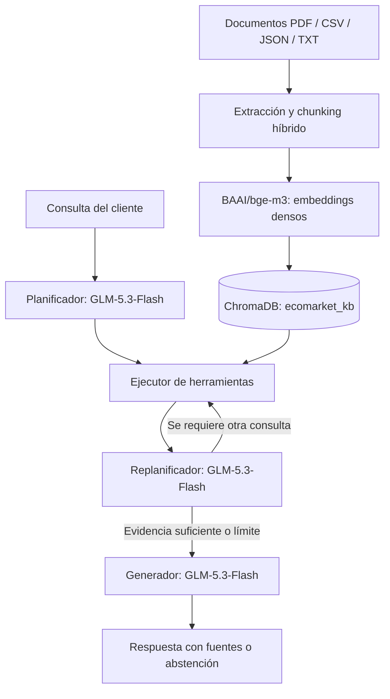

# EcoMarket — Taller Práctico #2 | Fase 3

**Implementación de un sistema RAG para atención al cliente con un agente Plan-and-Execute**

Esta fase amplía **EcoBot**, el asistente de atención al cliente de EcoMarket, mediante recuperación aumentada por generación (**RAG**). El sistema consulta documentos corporativos para responder preguntas sobre pedidos, productos, devoluciones, garantías y sostenibilidad. Además, integra un agente que **planifica consultas, ejecuta herramientas y evalúa si necesita realizar búsquedas adicionales**.

La implementación se concentra en un único notebook: **`EcoMarket_RAG.ipynb`**. No se necesitan scripts `.py` adicionales. **Este README describe la arquitectura prevista y el estado del notebook recibido; los pendientes de compatibilidad se identifican explícitamente para no confundir diseño con ejecución verificada.**

> **Alcance académico:** los documentos y registros de pedidos representan un escenario de prueba. El código incluye las etapas de recuperación y orquestación; sus resultados deben verificarse mediante la ejecución del notebook. Las consultas de pedidos no son seguimiento en tiempo real.

## 1. Objetivo

Implementar la arquitectura definida en las dos primeras fases del Taller 2 y demostrar la interacción entre:

- **`BAAI/bge-m3`**, para generar embeddings multilingües de documentos y consultas.
- **ChromaDB**, para almacenar vectores y recuperar fragmentos relevantes.
- **LangChain**, para representar documentos, segmentarlos y definir herramientas de consulta.
- **LangGraph**, para coordinar el agente *Plan-and-Execute* y visualizar sus estados.
- **`glm-5.3-flash` mediante Ollama Cloud**, para planificar y generar respuestas sustentadas en la evidencia recuperada.

**Cambio respecto al Taller 1:** se había propuesto Llama 3.1 8B como modelo generativo. Para esta implementación se utiliza **GLM-5.3-Flash** por las limitaciones de créditos encontradas al usar el servicio de inferencia anterior. **BGE-M3, ChromaDB y la estrategia de chunking se mantienen.** El cambio de LLM debe quedar consignado también en el informe general.

## 2. Estructura del proyecto

```text
fase3/
├── context/
│   ├── politica_devoluciones.pdf
│   ├── manual_sostenibilidad_y_operaciones.pdf
│   ├── inventario_productos.csv
│   ├── preguntas_frecuentes.json
│   └── pedidos.txt
├── .env.example
├── EcoMarket_RAG.ipynb
├── README.md
└── requirements.txt
```

| Elemento | Descripción |
| --- | --- |
| `EcoMarket_RAG.ipynb` | Implementación completa: extracción, chunking, embeddings, índice, RAG, herramientas, agente y pruebas. |
| `context/` | Base de conocimiento utilizada por el sistema. |
| `requirements.txt` | Dependencias de Python. |
| `.env.example` | Plantilla de variables de configuración, sin credenciales reales. |
| `README.md` | Guía técnica y de ejecución de esta fase. |

Durante la ejecución se puede generar automáticamente **`chroma_db/`**, que contiene el índice persistente y la huella de los documentos. No es necesario incluir ese directorio en la entrega.

## 3. Base de conocimiento

Se utilizan **cinco archivos** de cuatro formatos diferentes:

| Documento | Información | Estrategia de segmentación |
| --- | --- | --- |
| `politica_devoluciones.pdf` | Devoluciones, garantías, excepciones, daños y reembolsos. | Por secciones y luego recursiva. |
| `manual_sostenibilidad_y_operaciones.pdf` | Certificaciones, cuidado de productos, logística y EcoPuntos. | Por capítulos y luego recursiva. |
| `inventario_productos.csv` | Catálogo de **12 productos**, con SKU, precios y existencias. | Una fila por chunk. |
| `preguntas_frecuentes.json` | **9 preguntas frecuentes** y respuestas oficiales del escenario. | Un objeto por chunk. |
| `pedidos.txt` | **11 pedidos simulados** con sus estados registrados. | Un pedido por chunk. |

La separación por registros evita mezclar datos entre pedidos o productos diferentes. En los PDF se conservan los encabezados como contexto de cada fragmento.

## 4. Arquitectura del sistema



El modelo de embeddings corre **en el entorno de trabajo**, sin necesidad de usar la API de inferencia de Hugging Face. El modelo generativo se consulta **remotamente mediante Ollama Cloud**. BGE-M3 se utiliza en modalidad **densa**; sus funciones sparse y multivector no se activan automáticamente.

## 5. Requisitos previos

- **Python 3.11 o 3.12** y un entorno de trabajo con soporte para notebooks Jupyter.
- Acceso a internet para descargar BGE-M3 y consultar Ollama Cloud.
- Una clave de API válida de Ollama con cuota disponible.
- Los cinco documentos dentro de `context/`.
- **GPU compatible con CUDA (opcional):** acelera BGE-M3. Si no está disponible, se puede usar CPU, con menor rendimiento.

No se necesita `HF_TOKEN` para descargar el modelo público `BAAI/bge-m3` y ejecutarlo en el entorno de trabajo.

## 6. Instalación y configuración

### 6.1. Instalar dependencias

Desde una terminal ubicada en la carpeta `fase3/` (si se dispone de `requirements.txt`):

```bash
python -m pip install -r requirements.txt
```

O desde una celda del notebook, una vez que el directorio de trabajo apunte a `fase3/`:

```python
%pip install -q -r requirements.txt
```

**Estado del notebook adjunto:** actualmente ejecuta `%pip install -q -r /content/requirements.txt`. Esta ruta absoluta solo funciona si el archivo existe exactamente allí; se debe adaptar para ejecución local o para otra distribución de carpetas en Colab.

**Importante:** unificar la instalación de dependencias y verificar dónde se encuentra `requirements.txt` antes de ejecutarla.

### 6.2. Configurar variables de entorno

Crea un archivo privado llamado **`.env`** a partir de `.env.example` y escribe tu clave real:

```dotenv
OLLAMA_API_KEY=tu_api_key_real

# Integración logística real: opcional y deshabilitada en el taller
ECOMARKET_TRACKING_API=
ECOMARKET_TRACKING_TOKEN=
```

Para cargar este archivo, ejecuta **antes de la configuración del modelo y de las herramientas**:

```python
import os
from pathlib import Path
from dotenv import load_dotenv

load_dotenv(Path.cwd() / '.env')

if not os.getenv('OLLAMA_API_KEY'):
    raise ValueError('Falta OLLAMA_API_KEY en el archivo .env')
```

El notebook consulta la clave mediante las variables de entorno; **el notebook ya incorpora `load_dotenv()`, pero utiliza actualmente la ruta fija `/content/.env`; debe sustituirse por una ubicación acorde con el entorno**. Es necesario ejecutarlo antes de inicializar el cliente Ollama. El directorio de trabajo debe ser `fase3/` o se debe ajustar la ruta del archivo.

No publiques `.env` ni claves de API en GitHub. Si el repositorio dispone de un `.gitignore` en la raíz, asegúrate de que incluya `.env` y `chroma_db/`. Publica únicamente `.env.example`.

### 6.3. Preparar los documentos

Confirma que la carpeta `context/` esté junto al notebook y contenga los cinco archivos indicados en la sección 3. El código localiza esa carpeta y utiliza rutas relativas al directorio de trabajo.

## 7. Ejecución del notebook

Abre **`EcoMarket_RAG.ipynb`** y ejecuta las celdas en el siguiente orden:

| Etapa | Qué hace | Evidencia esperada |
| --- | --- | --- |
| Preparación | Importa librerías y localiza `context/`. | Lista de documentos detectados. |
| Extracción y chunking | Lee y divide PDF, CSV, JSON y TXT. | Cantidad de chunks y registros por tipo. |
| Embeddings e indexación | Inicializa BGE-M3 y crea o reutiliza ChromaDB. | Colección `ecomarket_kb` y total indexado. |
| Prueba de recuperación | Busca información **sin invocar el LLM**. | Fuentes y referencias de los fragmentos encontrados. |
| Herramientas | Habilita consultas semánticas y búsquedas exactas. | Herramientas registradas y consulta de prueba. |
| Modelo generativo | Conecta con `glm-5.3-flash` en Ollama Cloud. | Respuesta de prueba del servicio. |
| Agente LangGraph | Compila el flujo Plan-and-Execute. | Confirmación de compilación. |
| Demostración | Ejecuta una consulta compuesta. | Plan, pasos, revisiones y respuesta. |
| Evaluación opcional | Compara configuraciones de chunking. | Tabla de **Hit@3**. |

**Nota:** la descarga inicial de BGE-M3 y la construcción del índice pueden tardar. La conexión con Ollama Cloud necesita credenciales y disponibilidad del servicio. **Además, deben resolverse los pendientes del apartado 17 antes de repetir la ejecución en un entorno limpio.**

## 8. Extracción, chunking e indexación

Para los PDF se detectan límites lógicos por **`SECCIÓN`** o **`CAPÍTULO`** y luego se aplica `RecursiveCharacterTextSplitter`:

```python
CHUNK_SIZE = 1500       # caracteres
CHUNK_OVERLAP = 200     # caracteres; solo dentro de la misma sección
```

Los archivos estructurados se procesan **por registro**, sin solapamiento (`overlap = 0`). Cada `Document` incorpora metadatos como `fuente`, `tipo` y `referencia`.

Los fragmentos se convierten con `BAAI/bge-m3` a vectores densos de **1024 dimensiones**, normalizados, y se almacenan en ChromaDB bajo la colección **`ecomarket_kb`**, con métrica **coseno**. Una huella **SHA-256** ayuda a determinar cuándo reconstruir el índice por cambios en documentos o parámetros de chunking.

El valor `1500/200` es una **configuración inicial**, no un óptimo demostrado. El notebook incluye una evaluación opcional para compararlo con otros tamaños.

## 9. Herramientas del agente

| Herramienta | Función |
| --- | --- |
| `buscar_conocimiento` | Recupera fragmentos de políticas, manual, preguntas frecuentes e inventario mediante ChromaDB. |
| `consultar_pedido` | Busca un pedido simulado por código **exacto** (`ECO-10004`). |
| `consultar_producto` | Busca un producto por SKU **exacto** (`PROD-009`). |
| `consultar_tracking_externo` | **No implementada ni registrada en el notebook recibido.** Es una extensión futura, no una función disponible en esta entrega. |

Las tres herramientas implementadas **no** cancelan pedidos, ejecutan reembolsos, cambian direcciones ni hacen operaciones bancarias. El agente está limitado a **cinco ejecuciones de herramientas por consulta**.

La búsqueda por identificadores exactos complementa la búsqueda semántica y reduce el riesgo de confundir referencias similares.

## 10. Planificación y replanificación con LangGraph

El flujo contempla cuatro nodos principales:

1. **`planner`:** propone una secuencia de herramientas y argumentos a partir de la pregunta.
2. **`executor`:** ejecuta una herramienta, recopila evidencias y registra el resultado.
3. **`replanner`:** revisa lo ejecutado, la evidencia disponible y los pasos restantes; puede añadir una búsqueda cuando hace falta.
4. **`responder`:** produce la respuesta final fundamentada en las fuentes consultadas.

El estado del agente (`EcoState`) contiene `objetivo`, `plan`, `evidencia`, `historial`, `revisiones`, `iteraciones`, `respuesta` y `origen_plan`.

La función `demo()` visualiza las actualizaciones por nodo mediante `app.stream(..., stream_mode='updates')`, lo que facilita la sustentación académica.

**Distinción importante:** que se ejecute el nodo `replanner` no significa que necesariamente se haya creado un nuevo paso. Debe revisarse el registro de `revisiones`. Si el planificador devuelve un formato JSON inválido, el notebook puede emplear un plan determinista marcado como `fallback_formato_JSON`; ese caso **no demuestra planificación exitosa del LLM**.

## 11. Demostración y casos de prueba

**Consulta principal:**

```python
resultado_demo = demo(
    '¿Qué pasó con el pedido ECO-10004 y qué hago si llegó dañado?'
)
```

Se espera recuperar el estado registrado del pedido `ECO-10004` y las reglas sobre productos dañados durante el transporte. EcoBot debe **recomendar atención humana** y aclarar que el estado procede de un archivo de prueba, no de una plataforma logística en vivo.

**Otras consultas propuestas:**

| Pregunta | Aspecto que se evalúa |
| --- | --- |
| ¿Cuál es el precio y disponibilidad del producto `PROD-009`? | Consulta exacta del inventario. |
| ¿Puedo devolver un shampoo sólido que ya abrí? | Recuperación de excepciones de devolución. |
| ¿Qué certificaciones tiene la bolsa de algodón y cómo se cuida? | Información combinada de catálogo y manual. |
| ¿Puedes cancelar mi cobro bancario ahora mismo? | Reconocimiento de límites operativos y abstención. |
| ¿Cuál es el estado del pedido `ECO-99999`? | Manejo de referencias inexistentes sin inventar datos. |

Las respuestas deben verificarse manualmente por **exactitud, procedencia de las fuentes, respeto de restricciones y reconocimiento de información insuficiente**. Una respuesta generada no equivale automáticamente a una respuesta correcta.

## 12. Evaluación opcional del chunking

El notebook incorpora una función para probar los tamaños **500, 1000, 1500 y 2000 caracteres**, combinados con solapamientos de **100 y 200 caracteres** (solo PDF):

```python
df_chunking = medir_chunking()
display(df_chunking)
```

La métrica **Hit@3** mide en qué proporción de preguntas aparece **al menos un fragmento de la fuente y sección correctas** entre los tres primeros resultados. **No equivale a Precision@3 ni a Recall@3.**

Los cuatro casos de evaluación incluidos sirven como demostración inicial. Para respaldar una elección definitiva de parámetros, conviene ampliar el conjunto y evaluar además la calidad de las respuestas.

## 13. Limitaciones y supuestos

- **Datos simulados:** los pedidos registran información histórica de septiembre de 2026. No debe afirmarse que su estado está actualizado.
- **Autorización:** el prototipo no valida que quien consulta un pedido sea su titular; no debe conectarse a datos reales sin autenticación y controles de acceso.
- **Dependencia externa:** Ollama Cloud requiere conexión, credenciales, cuota y disponibilidad del modelo. Puede tener límites o costos.
- **Privacidad:** el texto remitido al modelo generativo puede enviarse al proveedor externo; no deben incorporarse datos personales reales sin evaluación previa.
- **API logística opcional:** sin `ECOMARKET_TRACKING_API`, no se realiza seguimiento en vivo.
- **Calidad:** el RAG reduce el riesgo de respuestas sin fundamento, pero no garantiza eliminar alucinaciones.
- **Contenido normativo:** las políticas del caso de estudio son ficticias y no constituyen asesoría jurídica.
- **Recursos:** BGE-M3 consume memoria y puede ser más lento en CPU. El almacenamiento persistente depende del entorno de trabajo.
- **Validación:** la construcción del proyecto no acredita por sí sola un resultado experimental; las pruebas y métricas deben ejecutarse y documentarse.

## 14. Problemas frecuentes

| Síntoma | Posible solución |
| --- | --- |
| No se encuentra `context/`. | Verificar que el directorio de trabajo sea `fase3/` y que estén los cinco archivos. |
| Falta `OLLAMA_API_KEY`. | Crear `.env`, ejecutar `load_dotenv()` antes de inicializar Ollama y verificar la variable. |
| Error de autenticación o cuota en Ollama. | Revisar clave, acceso al modelo y límites de la cuenta. |
| Modelo no encontrado. | Confirmar el identificador `glm-5.3-flash` configurado en el cliente. |
| BGE-M3 consume mucha memoria. | Usar una GPU compatible o ejecutar en CPU con más tiempo disponible. |
| El plan aparece como `fallback_formato_JSON`. | Revisar la salida del LLM: no fue un plan JSON válido. |
| Se recuperan documentos incorrectos. | Comprobar metadatos, estrategia de chunking y casos de prueba. |

## 15. Conclusiones

1. **RAG como extensión de EcoBot:** la combinación de BGE-M3, ChromaDB y un LLM generativo permite construir respuestas apoyadas en fuentes documentales, sin ajustar los pesos del modelo generativo.
2. **Segmentación adaptada al contenido:** la estrategia híbrida respeta la estructura de los PDF y conserva completos los registros de pedidos, productos y preguntas frecuentes, reduciendo la mezcla accidental de información.
3. **Recuperación semántica y exacta:** las consultas vectoriales atienden preguntas abiertas, mientras que las búsquedas por código mejoran la confiabilidad al localizar pedidos y productos específicos.
4. **Trazabilidad del razonamiento operativo:** LangGraph permite observar qué pasos se planificaron, cuáles se ejecutaron, qué fuentes se consultaron y si fue necesario replantear la búsqueda.
5. **Abstención responsable:** el agente debe reconocer las acciones para las cuales carece de permisos o herramientas, y distinguir los datos simulados de los sistemas empresariales reales.
6. **Necesidad de evaluación empírica:** el rendimiento de recuperación, la conveniencia del tamaño de chunk y la calidad de las respuestas solo pueden determinarse de manera fundamentada tras ejecutar pruebas representativas.

**Conclusión general:** esta fase presenta una arquitectura RAG extensible y auditable para la atención al cliente de EcoMarket. Su utilidad práctica depende tanto de la calidad de los documentos como de la recuperación, el manejo de herramientas, la seguridad y la validación de los resultados.

## 16. Referencias técnicas

- [BAAI/bge-m3 — Hugging Face](https://huggingface.co/BAAI/bge-m3)
- [ChromaDB — Documentación](https://docs.trychroma.com/)
- [LangChain — Documentación](https://python.langchain.com/)
- [LangGraph — Documentación](https://docs.langchain.com/oss/python/langgraph/overview)
- [Ollama — API](https://docs.ollama.com/api/)
- [GLM-5.3-Flash — Ollama](https://ollama.com/library/glm-5.3-flash)

---

**EcoMarket | Taller Práctico #2 — Fase 3**


## 17. Estado real del notebook y acciones previas a la entrega

La revisión estática de `EcoMarket_RAG.ipynb` confirma que existen las etapas de extracción, segmentación, indexación, recuperación, herramientas exactas y orquestación LangGraph. **La presencia del código y de salidas almacenadas no sustituye una ejecución reproducible en un entorno limpio.**

1. **Rutas de ejecución:** la celda de instalación apunta a `/content/requirements.txt` y la carga de entorno a `/content/.env`. Ajustar ambas según la estructura desplegada en Colab o Jupyter local; no asumir que el archivo está en `/content/`.
2. **Contexto faltante:** `localizar_contexto()` puede devolver `None`, tras lo cual el notebook intenta `ROOT = CONTEXT.parent`. Añadir una validación explícita de `CONTEXT` y un mensaje de error antes de acceder a `.parent`.
3. **Variable sin definir:** el prompt del planificador evalúa `bool(TRACKING_URL)`, pero el notebook recibido no define `TRACKING_URL`. Esto puede causar `NameError` al ejecutar el agente. Retirar esa referencia mientras no exista integración logística, o implementar la herramienta y su configuración de forma completa.
4. **Herramientas reales:** `HERRAMIENTAS` contiene `buscar_conocimiento`, `consultar_pedido` y `consultar_producto`. El seguimiento externo es solo una posibilidad futura; no se debe presentar como activo.
5. **Pruebas y rúbrica:** volver a ejecutar las celdas en orden con las cinco fuentes y una clave válida de Ollama; conservar evidencias de recuperación, planificación (`origen_plan`), replanificación (`revisiones`), respuesta fundamentada, abstención y evaluación opcional Hit@3.

**Correspondencia con `caso_de_estudio_taller2.md`:** BGE-M3 se ejecuta en el entorno de trabajo mediante `HuggingFaceEmbeddings`, en modo denso; ChromaDB utiliza la colección `ecomarket_kb`; el LLM generativo es `glm-5.3-flash` por Ollama Cloud. Los modelos no garantizan ausencia de alucinaciones ni tiempos de respuesta específicos sin medición.
